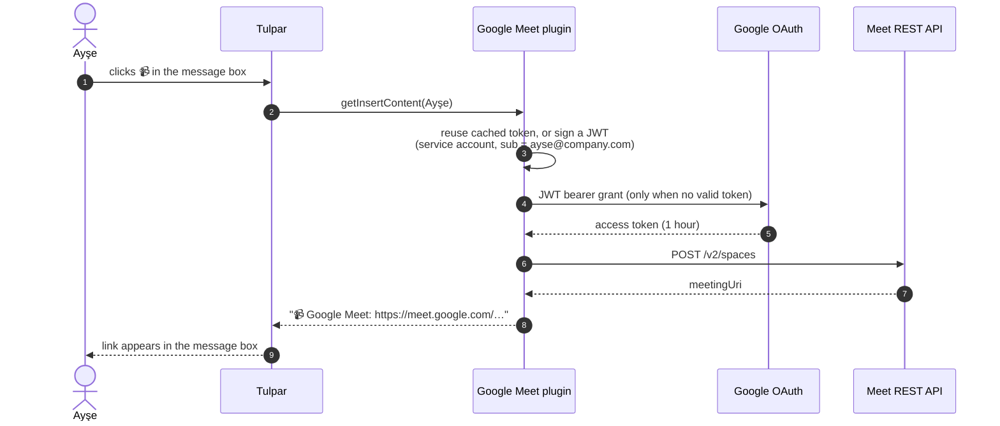

<div align="center">

# 📹 Google Meet for Tulpar

**One click in the message box. A fresh Google Meet link, created as you, dropped right into the conversation.**

[](https://www.tulpar.dev)
[](https://developers.google.com/meet/api/guides/overview)
[](https://github.com/aligundogdu/tulpar-google-meet-plugin/releases)
[](https://github.com/aligundogdu/tulpar-google-meet-plugin/actions/workflows/tests.yml)

[](https://www.php.net/)
[](composer.json)
[](#-how-it-works)
[](#-languages)
[](LICENSE)

[Install](#-install-in-one-click) · [Google setup](#-google-workspace-setup-5-minutes) · [Scenarios](#-made-for-these-moments) · [Troubleshooting](#-troubleshooting) · [Security](#-security--privacy)

</div>

---

## ✨ Why

"Let's jump on a call" usually means leaving the chat, opening Calendar or Meet, creating a room, copying the link, coming back and pasting it. Five context switches for one link.

With this plugin it is **one button**:

```
┌──────────────────────────────────────────────────────────────┐
│  Message #design-review                                      │
│                                                              │
│  📹 Google Meet: https://meet.google.com/abc-defg-hij        │
├──────────────────────────────────────────────────────────────┤
│  B  I  S  <>  ❝  •  1.  🔗  📎  😊  [📹]  🎲         ⏰  ➤   │
└──────────────────────────────────────────────────────────────┘
                                       ▲
                          click, link appears, press Enter
```

## 🚀 Features

| | |
|---|---|
| ⚡ **One click** | A new Meet space is created and the link lands in the message box, ready to send or edit |
| 👤 **Created as you** | The meeting belongs to the person who clicked, not to a shared bot account |
| 🔐 **No Google sign-in for anyone** | A Workspace service account with domain-wide delegation does the work quietly |
| 🎯 **Minimal permission** | Only `meetings.space.created`: it can create meeting spaces, nothing else. No Calendar, no Gmail, no Drive |
| 🧠 **Token caching** | Access tokens are reused per person until shortly before they expire, so repeated clicks are fast |
| 🗣️ **Speaks your language** | Errors appear in the person's Tulpar language (English and Turkish today) |
| 🪶 **Zero dependencies** | Plain PHP with `openssl`. No Google SDK, no Composer packages at runtime |
| 🧩 **Pure plugin** | No changes to Tulpar core. It uses the public plugin runtime context only |

## 🧭 How it works



## 📦 Install in one click

The plugin is listed in the [**Tulpar Marketplace**](https://github.com/Tulpar-Chat/plugins).

1. Open **Admin settings → Plugins → Marketplace**
2. Find **Google Meet** and click **Install**
3. Open the plugin's **Settings** and paste the service account key (see below)

That is it. Everyone in the workspace now has the 📹 button in their message box.

<details>
<summary><b>Manual install (self-hosted, no marketplace)</b></summary>

<br>

1. Download `plugin.zip` from the [latest release](https://github.com/aligundogdu/tulpar-google-meet-plugin/releases/latest)
2. Unpack it into your Tulpar server's plugin directory:

   ```bash
   unzip plugin.zip -d /path/to/tulpar/var/plugins/com.tulpar.google-meet
   ```

3. In **Admin settings → Plugins**, install it from disk and activate it
4. Paste the service account key into the plugin settings

</details>

## 🔧 Google Workspace setup (5 minutes)

You need a Google Workspace admin for steps 4 and 5.

| Step | Where | What to do |
|:---:|---|---|
| 1 | [Google Cloud Console](https://console.cloud.google.com/) | Create a project, for example **Tulpar** |
| 2 | APIs & Services → Library | Enable **Google Meet REST API** |
| 3 | IAM & Admin → Service accounts | Create a service account, then **Keys → Add key → JSON**. Keep the file safe |
| 4 | Same page, service account details | Copy the numeric **Unique ID** (about 21 digits) |
| 5 | [Admin console](https://admin.google.com/) → Security → Access and data control → API controls → **Domain-wide delegation** | **Add new**: Client ID = the Unique ID, OAuth scope = `https://www.googleapis.com/auth/meetings.space.created` |

Then paste the **entire JSON key** into **Tulpar → Admin settings → Plugins → Google Meet → Settings → Service account key (JSON)**.

> [!TIP]
> In the delegation form, the Client ID is the **numeric Unique ID**, not the service account email. Paste the scope as plain text with no spaces or quotes. If Google says the scope is invalid, one of these two is almost always the cause.

> [!NOTE]
> Delegation can take a few minutes to take effect after you save it.

## ⚙️ Configuration

| Setting | Required | Description |
|---|:---:|---|
| `serviceAccount` | ✅ | The full JSON key of the service account. Stored in Tulpar's plugin settings and shown as a password field |

| Permission | Why |
|---|---|
| `members:read` | To look up the clicking person's email address, which Google needs to create the meeting as them |

## 🎬 Made for these moments

<table>
<tr>
<td width="50%" valign="top">

### ☕ Daily stand-up
It is 09:58 and the team channel is quiet. Click 📹, add "stand-up in 2 min", press Enter. Everyone joins from the same message.

</td>
<td width="50%" valign="top">

### 🔥 Incident war room
Production is on fire. In the incident thread, one click gives everyone the same room, and the link stays next to the timeline of what happened.

</td>
</tr>
<tr>
<td valign="top">

### 🤝 Customer call
In a DM with a colleague: "Can you join the call with Acme?" The link is created as you, so you are the host and you control who gets in.

</td>
<td valign="top">

### 👩‍💻 Pair programming
A code review comment turns into "easier to show you". Click, send, share your screen. No calendar invite needed for a ten-minute session.

</td>
</tr>
<tr>
<td valign="top">

### 🧵 From async to sync
A thread has thirty replies and no decision. Drop a Meet link in the thread and settle it in five minutes, then post the outcome in the same thread.

</td>
<td valign="top">

### 🌍 Across time zones
The link is a plain Meet URL, so guests outside your Tulpar can join from the same message you forward to them.

</td>
</tr>
</table>

## 🩺 Troubleshooting

The plugin tells the person what went wrong in a toast. The usual causes:

| Message | Cause | Fix |
|---|---|---|
| *Google Meet is not set up yet…* | No key in the plugin settings | Paste the JSON key in the plugin settings |
| *The service account private key could not be read* | The pasted value is not the full JSON, or it was edited | Paste the whole file content again |
| *Google refused the service account… (unauthorized_client)* | Domain-wide delegation is missing, uses the email instead of the Unique ID, or has a different scope | Recheck step 5 of the setup |
| *Google refused the service account… (invalid_grant)* | The person's Tulpar email is not a user in your Google Workspace | Make sure Tulpar emails match Workspace accounts |
| *Google Meet could not create a meeting (… has not been used in project …)* | Meet REST API is not enabled in the project | Enable it in step 2 |

## 🔒 Security & privacy

- **Least privilege.** The only scope is `meetings.space.created`. The plugin cannot read calendars, mail, files or existing meetings.
- **Key stays on your server.** The service account key lives in Tulpar's plugin settings, which only server admins can see. It is never sent to browsers or mobile apps.
- **Short-lived tokens.** Access tokens last one hour, are stored per person in the plugin's own storage, and are not reused across people.
- **Acts as the person.** Every meeting is created on behalf of the person who clicked, so your Workspace audit logs show who created what.
- **Uninstall cleans up.** Removing the plugin deletes its settings and stored tokens.

## 🗣️ Languages

Messages follow the person's Tulpar language: **English** and **Turkish**. Adding a language is a matter of adding one entry per message in [`src/Plugin.php`](src/Plugin.php).

## 🗺️ Roadmap

- [x] One-click Meet link in the message box
- [ ] Meeting status: set your Tulpar status to 📹 *In a meeting* from your Google Calendar
- [ ] Optional meeting title and access settings (open, trusted, restricted)
- [ ] `/meet` slash command

## 🛠️ Development

```bash
git clone https://github.com/aligundogdu/tulpar-google-meet-plugin.git
cd tulpar-google-meet-plugin
composer install
composer test
```

Google is faked in the tests: they sign a real JWT with a generated RSA key and verify it against the public key, check token caching, and cover the error paths. Tulpar's `PluginContext` is stubbed in [`tests/stubs`](tests/stubs), so you do not need a Tulpar checkout.

**Releasing:** bump `version` in `plugin.json`, then

```bash
git tag v1.0.2 && git push --tags
```

The release workflow runs the tests, builds `plugin.zip`, and writes the ready-to-paste registry entry (URL and sha256) into the release notes.

## 📄 License

[MIT](LICENSE) © Ali Gündoğdu

<div align="center">
<br>
<sub>Built for <a href="https://www.tulpar.dev">Tulpar</a>, the team chat that lets you own your data.</sub>
</div>
